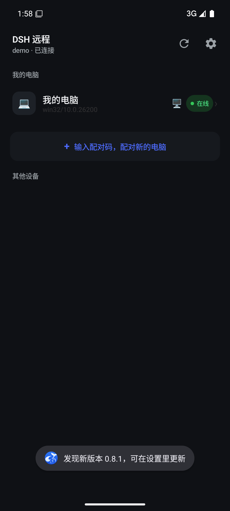
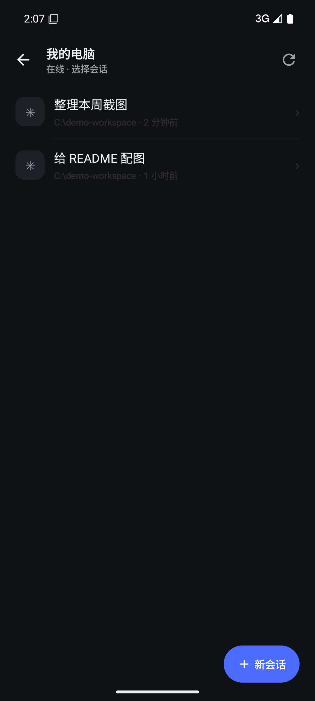
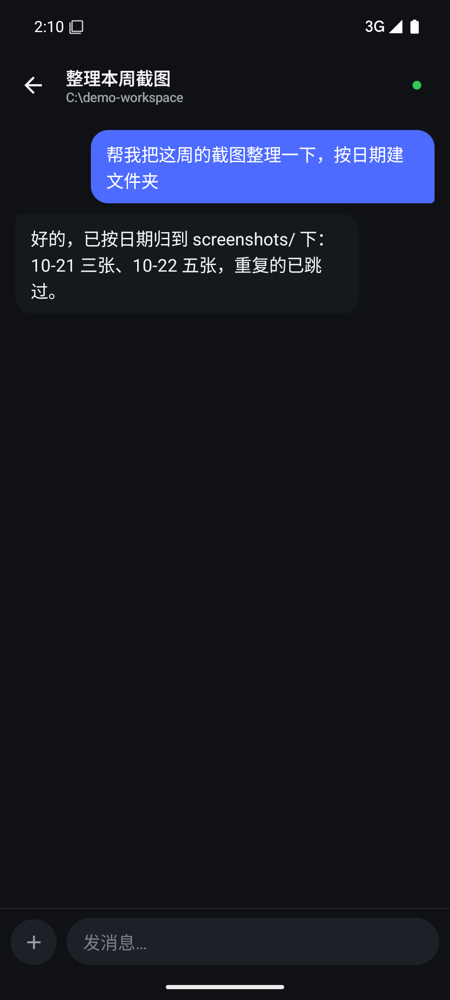
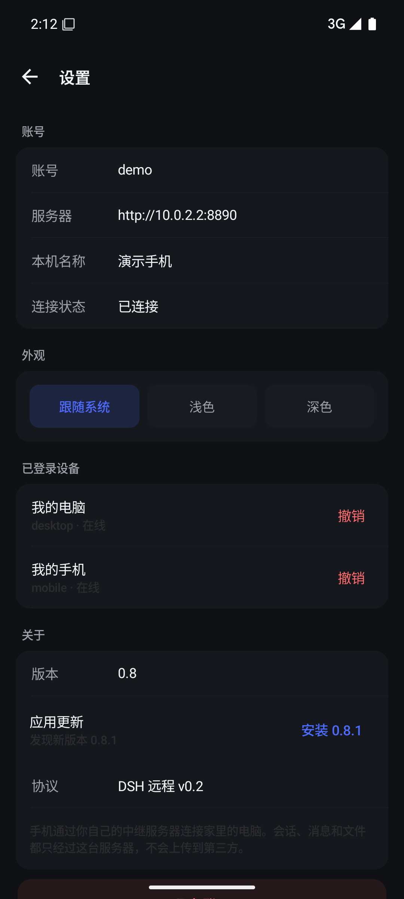

# DSH Console · 手机远程操作你的 DSH

[](https://github.com/Yylx-R/dsh-console/actions/workflows/ci.yml)
[](https://github.com/Yylx-R/dsh-console/actions/workflows/docker.yml)
[](https://github.com/Yylx-R/dsh-console/releases)
[](LICENSE)
[](android/)

把 [DeepSeek Harness](https://github.com/deepseek-ai) 的会话搬到手机上：手机发文字/图片/文件 →
**你自己的**中继服务器 → **你自己的**电脑执行 → 结果实时回到手机。

不依赖公网 IP、不用端口映射：电脑主动向外建长连接，手机连同一台中继即可。

```
┌─────────┐   HTTPS/WSS    ┌──────────────┐   WSS（出站）   ┌────────────────┐
│  手机   │ ─────────────► │  中继服务器   │ ◄───────────── │  电脑 DSH 插件  │
│ Android │ ◄───────────── │ Node + SQLite │ ─────────────► │  → DSH 会话     │
└─────────┘   消息/文件     └──────────────┘                 └────────────────┘
```

## 界面预览

| 我的电脑 | 会话列表 |
| --- | --- |
|  |  |

| 聊天（流式回复） | 设置（主题 / 设备 / 更新） |
| --- | --- |
|  |  |

## 特性

- **多设备、可分辨**：每台手机/电脑独立登录、独立命名，明确「谁在输入、哪台在执行」。
- **完整会话能力**：列会话、读历史、流式回复、发消息、停止任务、新建会话、切模型。
- **附件与交付物**：手机传图片/文件到电脑；电脑上的表格、文档等文件也能直接取回手机，点开即用系统应用打开（Android）。
- **屏幕与按键**：电脑画面按需截图回传，可远程 Alt+Tab / 回车 / 方向键等。
- **安全可控**：配对码 5 分钟一次性 + 电脑端人工确认；电脑端可「紧急停止」；任一方可单方面解除。
- **多账号**：一台服务器可给家人/同事共用，账号之间互相不可见，邀请码注册。
- **两种客户端**：Android 原生 App（Kotlin + Compose）与免安装 PWA（浏览器打开即用）。

## 仓库结构

```
relay/        中继服务器（Node 24 + ws + SQLite）+ 内置手机网页版 public/
dsh-plugin/   电脑端 DSH 插件（Host 插件，出站连接中继）
android/      Android 客户端（Kotlin + Jetpack Compose）
deploy/       Docker Compose、Caddy、初始化与备份脚本、部署手册
scripts/      配对、发布、联调脚本
docs/         设计方案（架构、协议、数据模型、路线图）
```

## 快速开始

### 1. 中继服务器（一键部署）

**你不需要自己的服务器**——这套东西是自托管的：谁想用，就部署到自己的机器上。一台 2 核 2G 的小机器足够（5~10 人、10~25 台设备），甚至树莓派/NAS 也行。

```bash
git clone https://github.com/Yylx-R/dsh-console.git dsh-console
cd dsh-console

# 有域名（自动申请证书、开 HTTPS）
sudo bash deploy/install.sh --domain relay.example.com --email you@example.com

# 没域名（HTTP 直连 80 端口，仅建议内网/试用）
sudo bash deploy/install.sh
```

脚本会自动：装 Docker → 写 `.env` → 构建并启动 relay（+ Caddy 自动 HTTPS）→ 健康检查 → 打印访问地址。

想卸载时（默认保留数据）：

```bash
sudo bash deploy/uninstall.sh           # 删容器和网络，data/ 保留
sudo bash deploy/uninstall.sh --purge   # 连数据库、上传文件、证书一起删
```

也可以用预构建镜像，省掉本地构建（镜像默认私有，需先 `docker login ghcr.io`；不登录就用默认的本地构建）：

```bash
sudo bash deploy/install.sh --image ghcr.io/yylx-r/dsh-console-relay:latest --domain relay.example.com --email you@example.com
```

升级 = `docker compose pull && docker compose up -d`；数据全在 `deploy/data/`，备份 `bash deploy/backup.sh`。
从零装系统（含 swap、BBR、防火墙、fail2ban）见 [`deploy/SERVER-SETUP.md`](deploy/SERVER-SETUP.md)。

### 2. 电脑端插件

```bash
# 在 DSH 的 profile 目录里安装本仓库的插件
dsh plugin --profile desktop add /path/to/dsh-plugin
```

装好后重启 DSH，打开 `http://127.0.0.1:<端口>/remote-control` 填服务器地址、账号、密码。
（也可以跑 `node scripts/setup-pc.mjs` 直接写配置。）

### 3. 手机端

- **PWA**：浏览器打开 `https://your.domain`，登录后「添加主屏」即可。
- **Android**：`cd android && ./gradlew assembleDebug`，装 `app-debug.apk`。

### 4. 配对

```bash
node scripts/pair.mjs          # 电脑上生成 8 位配对码
```

手机登录同一账号 → 输入配对码 → 电脑终端确认 `y`。之后手机上选电脑、选会话即可开聊。

## 安全

- 中继**能读到**消息与附件正文（**没有端到端加密**），自建时请知情。
- 配对 5 分钟一次性，必须电脑端确认；任一方可单方面解除，立即踢线并作废旧配对。
- 默认 HTTP 仅用于本地演示；公网部署请用 Caddy + Let's Encrypt 或 Cloudflare Tunnel。
- 手机端只能调用白名单指令（会话/附件/截屏/少量按键），终端与插件安装默认关闭。

详见 [SECURITY.md](SECURITY.md) 与 [docs/DESIGN.md](docs/DESIGN.md)。

## 开发

```bash
# relay：冒烟测试（不需要真实手机）
node relay/test/smoke.mjs

# 用假电脑跑通配对与会话
node scripts/sim-desktop.mjs
```

- 中继：Node 24、`ws`、`node:sqlite`，无其他运行时依赖。
- 插件：纯 ESM，无第三方依赖。
- Android：Gradle wrapper，Compose BOM 2024.10。

## 许可证

[MIT](LICENSE)。第三方依赖许可见各自包（`ws` MIT、AndroidX Apache-2.0、OkHttp Apache-2.0）。

> 本项目是第三方工具，与 DeepSeek 官方无关；不包含 DSH 本体。
