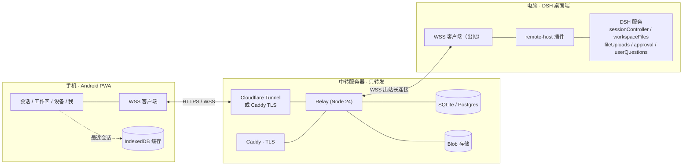
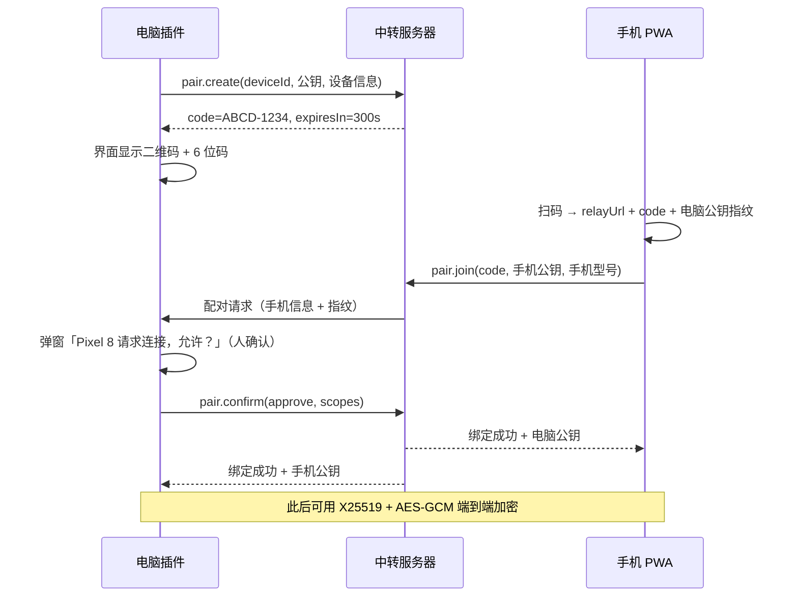
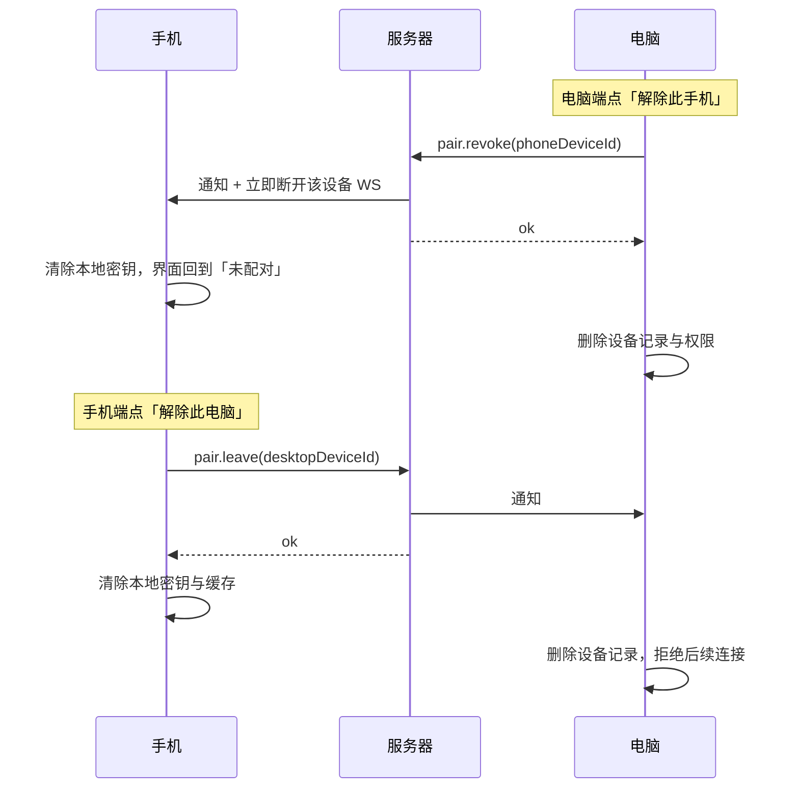

# DSH 手机远程控制插件 · 设计方案 v0.2

> 目标：人在外面，用手机给家里的电脑发一句话 / 一张图 / 一个文件，电脑上的 DSH 干活，结果实时回到手机。
> 参考产品：联想「超级文件」的多设备登录与设备区分；DeepSeek App 的会话界面。
> 本文只做设计，不含实现代码。

**v0.2 变更（依据 2026-10-26 的决策）**

| 决策 | v0.1 | v0.2 |
|---|---|---|
| 使用范围 | 未定 | **家人/同事共 5~10 人，独立账号 + 邀请码** |
| 服务器 | 香港/大陆二选一 | **阿里云（300 元券），大陆机 + Cloudflare Tunnel 免备案** |
| 手机端 | PWA 优先 | **Android PWA 优先**；国内推送受限，Phase 3 上 Capacitor 壳 |
| 安全边界 | 默认最小权限 | **手机可完全操作**；双方均可单方面解除，复用需重新配对 |
| 文件落点 | 工作区 ./inbox | **每台电脑自定义目录**（有默认值），设置页可改服务器地址 |

---

## 0. 结论速览

| 项 | 结论 |
|---|---|
| 整体形态 | **电脑端 DSH Host 插件（出站长连接） + 中转服务器（只转发） + 手机 PWA** |
| 需要公网 IP 吗 | **不需要**。电脑主动连服务器，天然穿透 NAT |
| 需要备案吗 | 大陆机走 **Cloudflare Tunnel 出站** 可免备案；或直接买香港节点 |
| 需要改 DSH 内核吗 | **不需要**。插件通过 `ctx.sessionController` / `ctx.workspaceFiles` / `ctx.approval` 等现有服务驱动 |
| 手机端 | **Android PWA**（Chrome 安装到桌面）；国内后台推送受限，Phase 3 套 Capacitor |
| 首版工期 | **10~14 天**（多了多账号与双向解除，比 v0.1 多 3~4 天） |
| 服务器 | **阿里云轻量 2 核 2G / 40GB / 3Mbps**，约 ¥68~100/月，300 元券可跑 3~7 个月 |
| 最大风险 | 安全：手机完全操作 + 手机丢失。用「双向解除 + 手机解锁 + 紧急停止 + 审计」兜底 |

---

## 1. 目标与非目标

### 1.1 目标

- **G1 远程输入**：手机发文字、图片、文件，电脑端 DSH 收到并执行。
- **G2 实时回传**：助手输出流式回到手机，工具调用、思考过程可见（可折叠）。
- **G3 同步工作区**：手机能看到电脑上的工作区列表、会话列表、文件树、本次改动 diff。
- **G4 多设备区分**：一个账号下多台电脑，手机端明确显示"在哪台执行"，可切换（借鉴超级文件）。
- **G5 完全操作**：手机可以发消息、批准工具执行、回答问题、切模型、改文件 —— 与坐在电脑前基本等价。
- **G6 双向解除**：电脑可单方面踢掉手机，手机也可单方面解绑；解除后必须**双方重新配对**才能再用。
- **G7 多用户**：5~10 人各自独立账号，共用一台服务器，互不可见；每台电脑自定义文件落点。

### 1.2 非目标（首版明确不做）

- 不在服务器上跑任何 agent / 模型 / 代码，服务器**只做消息和文件的中转**。
- 不把 DSH 的 `/api` 直接暴露到公网（那是完整的 RCE 面）。
- 不做多租户计费、不做团队共享空间（v2 可选）、不做 Web 管理后台。
- 不做手机端直接 shell（`terminal` 默认关，可手动开）。
- 不做离线执行：电脑关机就是离线，消息排队，不幻觉。

---

## 2. 总体架构



### 数据流一句话版

1. 手机把「发消息」写成一条加密信封 → WSS → 服务器。
2. 服务器查路由表，转发给目标电脑的那条长连接（电脑离线就落库排队）。
3. 电脑插件解包，调用 `ctx.sessionController.prompt(...)`，然后 `follow(...)` 订阅流。
4. 流式帧沿原路回传，手机边收边渲染。
5. 图片/文件走独立 HTTP 通道（分片上传、断点续传），不进 WSS 主通道。

---

## 3. 五个关键决策与理由

### D1 · 电脑端做出站长连接，不做端口映射 / 内网穿透

| 方案 | 评价 |
|---|---|
| 端口映射 / 公网 IP | 家里宽带多数没公网 IP，有也不安全（DSH 直接暴露） |
| frp / ngrok 类穿透 | 能用，但多一个中间件、多一份配置，且同样把 `/api` 暴露出去 |
| **出站 WSS（选定）** | 电脑主动连服务器，NAT 后面也能用；服务器只认"这条连接属于哪台设备" |

代价：电脑必须能访问服务器域名（出境线路抖动要接受）。**断线自动重连 + 指数退避**是必备的。

### D2 · 手机走「自定义窄协议」，不直接透传 DSH 的 `/api`

DSH 的 gateway 是按 `principal` 授权的，默认只有 `owner`；非 owner 需要注册 principal kind + policy，而且授权面是**整个 API**（含插件安装、终端、文件写）。

| | 直接透传 `/api` | 自定义窄协议（选定） |
|---|---|---|
| 工作量 | 小（复用 RPC） | 中（要写映射层） |
| 安全面 | 全 API = 全机器 | 白名单方法，逐设备授权 |
| 手机 UI | 桌面版 UI 直接塞手机，体验差 | 为手机重做，DeepSeek App 风格 |
| 版本耦合 | 与 DSH 内部 RPC 强耦合 | 协议自带版本号，可兼容 |

**结论**：v1 走窄协议。即使手机要"完全操作"，也是**在白名单方法里给全权限**，而不是把整个 API 暴露出去 —— 两者风险差一个数量级。

### D3 · 手机端先 PWA（Android）

- 免审核、免开发者账号、免双端维护。
- **Android 是 PWA 最友好的平台**：Chrome 可直接"安装应用"，有独立图标、全屏、Service Worker。
- 但国内 Android 有两个坑，必须提前认：
  1. **推送**：Web Push 走 FCM，国内网络不通 → 后台通知基本不可用。
  2. **浏览器**：华为/小米/OPPO 自带浏览器对 PWA 支持差 → 引导用户用 Chrome/Edge。
- 对策：Phase 1~2 靠"前台 WS 实时 + 打开即补拉"；Phase 3 套 **Capacitor 壳**接极光/个推或厂商通道。

### D4 · 中转只转发，执行永远在电脑

- 电脑有算力、有模型 key、有工作区文件；服务器只有 2 核。
- 隐私：代码和文件不落在第三方机器上（配合 E2E 更彻底）。
- 成本：中转的负载是 IO，不是 CPU。

### D5 · E2E 从第一天就在协议里留位

首版可以先只靠 TLS，但信封里必须有 `enc` 字段。等配对流程稳定后开 E2E：
**X25519 静态-静态 ECDH → HKDF-SHA256 → AES-256-GCM**，服务器只看到 `{to, nonce, ciphertext}`。
这个改动只在两端，不涉及服务器 —— 但**协议字段现在不留，后面就要改协议**。

---

## 4. 账号与设备模型（借鉴超级文件）

### 4.1 三层

```
服务器
 └── 账号 User（邀请码注册，5~10 人，互相独立）
      └── 设备 Device（各自有名字、平台、公钥、在线状态）
           ├── 电脑 executor（Windows / macOS / Linux，跑 DSH）
           └── 手机 controller（Android / iOS，只输入、只看）
```

### 4.2 多账号怎么落地（v1 选独立账号）

| 模式 | 说明 | 取舍 |
|---|---|---|
| **独立账号（选定）** | 每人一个账号，A 看不到 B 的设备/会话/文件，只共用服务器 | 简单、隐私好、权限边界清晰 |
| 共享空间 | 同一空间内设备互见，可跨人发消息（更像超级文件） | 需要成员/角色/权限模型，v2 再考虑 |

注册方式：**邀请码**。管理员（你）在服务器生成 8 位邀请码，有效期 7 天、限用 N 次；朋友在手机端输入邀请码 + 设置密码/Passkey 即注册。

### 4.3 设备卡片长什么样

手机「设备」页每张卡片：

```
┌────────────────────────────────┐
│ 🖥  我的台式机            ● 在线 │
│    Windows 11 · DSH 0.9.2       │
│    3 个工作区 · 上次活跃 2 分钟前 │
│    [ 设为默认执行设备 ]           │
└────────────────────────────────┘
┌────────────────────────────────┐
│ 💻 公司笔记本            ○ 离线  │
│    macOS 15 · 上次活跃 3 小时前   │
└────────────────────────────────┘
```

### 4.4 设备区分怎么用

- 每条消息带 `targetDeviceId`；不指定就用「默认执行设备」。
- 输入框上方常驻设备切换 chip：`发给：我的台式机 ▾`。
- 同一会话绑定一台电脑（会话 id 是那台电脑上的），切设备等于切工作区上下文 —— UI 上要讲清楚，避免"我在 A 电脑的会话里，消息却发到 B"。

---

## 5. 配对与解除

### 5.1 配对流程



要点：

- 二维码内容：`dshremote://pair?r=wss%3A%2F%2Frelay.example.com&c=ABCD1234&fp=<电脑公钥指纹前16位>`
- 6 位码用于手动输入（没相机、或二维码在另一台设备上）。
- **有效期 5 分钟、一次性、必须在电脑端人工点"允许"** —— 这三条缺一不可。
- 配对时同时确定权限档位（默认 `full`，见 7.4）。

### 5.2 双向单方面解除（v0.2 新增）



**解除后的语义（重要）**：

- 解除是**单方面、立即生效**的，不需要对方同意。
- 解除后：该配对的双向消息全部拒绝；服务器删除路由；本地删除公钥/密钥。
- 再次使用：**必须重新走完整配对流程**（二维码 + 双方确认），旧密钥不复用。
- 电脑端额外提供「紧急停止」：一键断开**所有**远程设备并暂停远程执行（保留配对记录，可恢复）。

---

## 6. 协议设计

### 6.1 传输

| 通道 | 用途 |
|---|---|
| `wss://relay/ws` | 控制面 + 会话流（JSON 文本帧） |
| `https://relay/blob/*` | 图片/文件上传下载（分片、断点续传） |
| `https://relay/push/*` | 推送订阅（Phase 3） |

### 6.2 信封

```ts
type Frame =
  | { t: 'hello';    v: 1; deviceId: string; token: string; proto: 1; caps: string[] }
  | { t: 'welcome';  v: 1; serverTime: number; peers: PeerInfo[]; cursor?: number }
  | { t: 'peer';     deviceId: string; online: boolean; lastSeenAt?: number }
  | { t: 'msg';      id: string; from: string; to: string; seq: number;
                     enc: 'none' | 'x25519-aesgcm'; body: unknown | string }
  | { t: 'ack';      id: string; seq: number }
  | { t: 'blob';     op: 'begin' | 'end'; blobId: string; size: number; sha256?: string }
  | { t: 'ping' } | { t: 'pong' }
  | { t: 'error';    code: string; message: string; retryAfterMs?: number }
```

### 6.3 应用层方法（`body.method`）

**设备 / 工作区**

| 方法 | 方向 | 入参 | 出参 |
|---|---|---|---|
| `device.info` | 手机→电脑 | `{}` | `{name, os, dshVersion, workspaces, scopes}` |
| `workspace.list` | 手机→电脑 | `{}` | `WorkspaceSummary[]` |
| `workspace.tree` | 手机→电脑 | `{path, depth}` | `Entry[]` |
| `file.read` | 手机→电脑 | `{path, range?}` | `{blobId, size}` |
| `file.put` | 手机→电脑 | `{name, size, sha256}` | `{path}`（先传 blob，再提交） |
| `diff.get` | 手机→电脑 | `{sessionId, seq}` | `{files, patch}` |

**会话**

| 方法 | 方向 | 入参 | 出参 |
|---|---|---|---|
| `session.list` | 手机→电脑 | `{workspaceId?, limit?}` | `SessionSummary[]` |
| `session.open` | 手机→电脑 | `{sessionId, maxMessages?}` | `{header, records, cursor, hasMore}` |
| `session.page` | 手机→电脑 | `{sessionId, beforeSeq}` | `{records, hasMore}` |
| `session.subscribe` | 手机→电脑 | `{sessionId}` | 持续推送 `event.push` |
| `session.unsubscribe` | 手机→电脑 | `{sessionId}` | `{ok}` |
| `session.create` | 手机→电脑 | `{workspaceId?, cwd?}` | `{sessionId}` |

**输入 / 控制**

| 方法 | 方向 | 入参 | 出参 |
|---|---|---|---|
| `prompt.send` | 手机→电脑 | `{requestId, sessionId, text?, attachments?, mode:'queue'\|'steer'}` | `{accepted}` |
| `prompt.cancel` | 手机→电脑 | `{sessionId}` | `{ok}` |
| `approval.respond` | 手机→电脑 | `{approvalId, decision:'allow'\|'deny'}` | `{ok}` |
| `question.answer` | 手机→电脑 | `{callId, answer}` | `{ok}` |
| `model.catalog` | 手机→电脑 | `{}` | `{models}` |
| `model.select` | 手机→电脑 | `{sessionId, provider, model}` | `{ok}` |

**电脑→手机 主动推送**

| 事件 | 说明 |
|---|---|
| `event.push` | 会话事件（增量） |
| `stream.push` | 助手流式片段（text / reasoning / tool-call） |
| `approval.request` | 需要审批 |
| `question.request` | 需要回答 |
| `device.status` | 运行中 / 空闲 / 出错 |

### 6.4 流式与断线续传

- 每条消息带 `seq`（每对设备单调递增），服务器对每对 `(from,to)` 维护**环形缓冲**（最近 2000 帧 / 10 分钟）。
- 重连时 `hello.cursor = 最后收到的 seq`，服务器补发缺口；缺口太大就回 `resync`，手机重新 `session.open`。
- `prompt.send` 用 `requestId` 幂等去重（电脑端 LRU 保留 10 分钟），防止重连导致重复执行 —— **这条很关键，重复执行 `rm` 是要出事的**。

### 6.5 错误码

`auth/expired`、`auth/revoked`、`device/offline`、`session/not-found`、`scope/denied`、`blob/too-large`、`rate/limited`、`internal`。

---

## 7. 电脑端插件（Host 插件）

### 7.1 包结构

```
packages/
  dsh-plugin-remote/          # Host 插件（本机执行侧）
    src/index.ts              # 注册、生命周期、配置读取
    src/relay-client.ts       # 出站 WSS、心跳、指数退避重连
    src/protocol.ts           # 帧类型 + 运行时校验（zod/valibot）
    src/handlers/session.ts   # 会话/消息/流
    src/handlers/workspace.ts # 工作区/文件/diff
    src/handlers/input.ts     # 审批/提问应答
    src/pairing.ts            # 配对码、二维码、公钥交换、解除
    src/scopes.ts             # 每台手机的权限判定
    src/store.ts              # 本地持久化（设备、权限、审计、配置）
  dsh-client-remote/          # 客户端 UI：设置页「远程访问」
  relay/                      # 中转服务器（独立部署，不进 DSH）
  mobile/                     # PWA（Vite + React）
```

### 7.2 依赖的 DSH 服务（已核对存在）

| 手机动作 | 电脑端实际调用 |
|---|---|
| 列工作区 | `ctx.workspaceRegistry.list()` |
| 列会话 | `ctx.sessionController.list({})` |
| 打开会话 | `ctx.sessionController.page({ address, maxMessages })` |
| 订阅流 | `ctx.sessionController.follow({ address, assistantStream: true })` |
| 发消息 | `ctx.sessionController.prompt({ requestId, sessionId, mode, content })` |
| 取消 | `ctx.sessionController.cancel({ sessionId })` |
| 传图 | `ctx.attachments.saveImage(...)` → 拼进 `content` 的 `image` part |
| 传文件 | `ctx.fileUploads.uploadStream({ sessionId, data, name })` → `bindPrompt` |
| 文件树 | `ctx.workspaceFiles.list(scope, path)` |
| 文件内容 | `ctx.workspaceFiles.read(scope, path, range)` |
| 改动 diff | `ctx.workspaceChanges.diff(sessionId, seq, index)` |
| 审批 | `'approval/request'` 事件应答 / `ctx.approval` |
| 回答问题 | `ctx.userQuestions.answer(agent, callId, answer)` |
| 模型列表 | `ctx.sessionController.modelCatalog()` |

### 7.3 生命周期

```ts
// 伪代码，示意注册方式
ctx.effect(() => {
  const client = new RelayClient(config)      // 出站长连接
  client.on('msg', routeToHandlers)            // 白名单分发
  client.connect()
  return () => client.dispose()                // 插件卸载即断开
})
```

- 重连：1s → 2s → 4s → … → 60s 封顶，带 ±20% 抖动。
- 心跳：30s 一次 `ping`，90s 无响应判死。**Cloudflare 免费版会断空闲连接，30s 心跳正好卡在安全区**。
- 断线期间手机发来的消息落服务器离线队列（TTL 24h），恢复后按序补投。

### 7.4 权限模型（v0.2 改为「完全操作 + 可收紧」）

默认档位 **`full`**：手机与坐在电脑前基本等价。

| scope | 含义 | 默认 | 可关 |
|---|---|---|---|
| `chat.read` | 看会话列表与历史 | ✅ | ✅ |
| `chat.send` | 发消息、取消 | ✅ | ✅ |
| `files.read` | 读工作区文件 | ✅ | ✅ |
| `files.write` | 往工作区写文件 | ✅ | ✅ |
| `approval.respond` | 代替你批准工具执行 | ✅ | ✅ |
| `model.select` | 切模型 | ✅ | ✅ |
| `terminal` | 看/开终端 | ❌ | ✅（手动开） |

因为默认全开，必须有**补偿控制**：

1. **手机解锁**：打开 PWA 需 PIN 或指纹（WebAuthn），防止捡到手机直接用。
2. **紧急停止**：电脑端一键断开所有远程设备、暂停远程执行（配对保留，可恢复）。
3. **双向解除**：任一方单方面解除，立即生效，重连需重新配对。
4. **审计日志**：谁在什么时候发了什么、批了什么，双端可查，电脑端留存 30 天。
5. **可选高危确认**：设置里可开「危险命令必须电脑端确认」（`rm -rf`、`format`、`sudo`、写系统目录），默认关（因为你要完全操作）。

### 7.5 电脑端 UI（设置页）

「设置 → 远程访问」：

- 服务器地址（可编辑 + 「测试连接」按钮）—— 支持自建/换服务器
- 连接状态（已连接 / 重连中 / 未配置）
- 设备名（显示给手机看）
- **文件接收目录**（默认 `%USERPROFILE%\DSH-Inbox`，可自选任意路径）
- 单文件上限（默认 50MB）、是否允许写入工作区
- 「配对手机」按钮 → 二维码 + 6 位码 + 倒计时
- 已配对设备列表：名称、平台、最后活跃、权限勾选、**解除**
- 紧急停止开关
- 审计日志

### 7.6 配置示意

```yaml
# cordis.patch.yml 片段（字段名以最终实现为准）
- id: remote-host
  name: dsh-plugin-remote
  config:
    relayUrl: wss://relay.example.com/ws
    deviceName: 我的台式机
    inboxDir: E:\插件设计\inbox        # 自定义，默认 %USERPROFILE%\DSH-Inbox
    maxFileMB: 50
    allowWorkspaceWrite: false
    autoConnect: true
```

---

## 8. 手机端（Android PWA）

### 8.1 技术栈

Vite + React + TypeScript + Tailwind；状态用 zustand，请求缓存用 TanStack Query；`vite-plugin-pwa` 出 manifest + service worker；WebCrypto 做 E2E 与解锁；IndexedDB 存最近会话。

### 8.2 页面结构（DeepSeek App 风格，底部 4 tab）

```
对话            工作区           设备            我
├ 会话列表      ├ 工作区切换      ├ 我的电脑       ├ 账号
├ 运行中标记    ├ 文件树          ├ 在线状态       ├ 通知设置
└ 新建会话      └ 本次改动 diff   └ 配对新设备     ├ 权限管理
                                                 └ 服务器地址
```

### 8.3 会话页

```
┌──────────────────────────────────┐
│ ‹  修复登录超时      我的台式机 ▾ │  ← 顶部：会话名 + 执行设备
├──────────────────────────────────┤
│  你：登录页一直转圈，帮我看看      │
│                                  │
│  ▸ 思考过程（3 步，点击展开）      │
│  ▸ 读取 src/auth/login.ts         │  ← 工具调用折叠卡片
│  ▸ 执行 npm test（输出 42 行）     │
│                                  │
│  找到原因了：token 刷新时……       │  ← 流式输出，带光标
│                                  │
├──────────────────────────────────┤
│ [图片] [文件] 输入消息…    [发送]  │
└──────────────────────────────────┘
```

- 助手输出用 SSE 式增量渲染，**断线重连后从 `cursor` 续接**，不整段重画。
- 工具卡片默认折叠，显示"工具名 + 一行摘要 + 耗时"；点开看完整输入输出。
- 审批请求以**底部弹层**出现：`允许执行 npm install？[拒绝] [允许]`。
- 长按消息可复制、可"在电脑上打开"。

### 8.4 附件策略

| 类型 | 处理 |
|---|---|
| 拍照 / 相册 | 客户端压缩到长边 2048、JPEG q80（约 1~2MB），再上传 |
| 文档 | 原样上传，>10MB 走分片；单文件上限默认 50MB |
| 落盘位置 | 目标电脑配置的 `inboxDir`（默认 `%USERPROFILE%\DSH-Inbox`），或按开关直接进工作区 |

### 8.5 推送的现实（Android + 国内）

| 方式 | 可用性 | 结论 |
|---|---|---|
| Web Push（FCM） | 国内无 GMS，基本不通 | ❌ 不能作为主方案 |
| 前台 WS 实时 | 打开着就通 | ✅ Phase 1~2 先用 |
| 打开即补拉 + 未读角标 | 不依赖推送 | ✅ 兜底 |
| Capacitor 壳 + 极光/个推/厂商通道 | 需原生壳，免费额度够小团队 | ✅ Phase 3 |
| 厂商通道直连（小米/华为/OPPO/vivo） | 最稳，接入成本高 | 可选 |

**Phase 3 计划**：Capacitor 壳 + 极光推送（或个推），保留 PWA 作为免安装入口。壳里还能申请前台服务，规避 Android 电池优化杀进程。

### 8.6 离线行为

- 断网：显示"已离线，消息将在恢复后发送"，写入 IndexedDB 发件箱。
- 电脑离线：消息进服务器队列，手机显示"已送达服务器，等待电脑上线（保留 24 小时）"。

---

## 9. 中转服务器

### 9.1 组件

```
Cloudflare Tunnel（或 Caddy TLS）
  └── Relay (Node 24 + ws)
        ├── SQLite（WAL）
        ├── Blob 目录（或 S3/R2）
        ├── 邀请码 / 账号
        └── /healthz、/metrics
```

首版用 **SQLite + 本地磁盘** 就够（10 人以内），并发再上来换 Postgres + Redis。

### 9.2 表结构（核心 8 张）

```sql
users(id, handle, password_hash, role, created_at, disabled_at)
invites(code, created_by, max_uses, used, expires_at)
devices(id, user_id, kind, name, platform, pubkey, token_hash,
        created_at, last_seen_at, revoked_at)
pairings(code, user_id, desktop_device_id, expires_at, used_at)
messages(id, user_id, from_device, to_device, seq, body, enc,
         created_at, delivered_at, expires_at)     -- 离线队列，TTL 24h
blobs(id, user_id, size, sha256, storage_key, created_at, expires_at)  -- TTL 7d
audit(id, user_id, device_id, action, target, result, created_at)
push_subs(id, user_id, device_id, endpoint, keys_json, created_at)
```

### 9.3 服务器要做什么 / 不做什么

| 做 | 不做 |
|---|---|
| 账号、邀请码、设备注册、在线状态 | 跑 agent / 调模型 |
| 配对码、二维码、解除通知 | 存工作区文件（只存传输中的 blob，7 天过期） |
| 消息路由、离线队列 | 解密消息内容（E2E 后） |
| blob 暂存与转发 | 执行任何命令 |
| 推送 | 长期业务数据（会话历史留在电脑上） |

### 9.4 部署（阿里云 + Cloudflare Tunnel）

```yaml
# docker-compose.yml（示意）
services:
  relay:
    build: ./relay
    restart: unless-stopped
    environment:
      - PORT=8787
      - DB_PATH=/data/relay.db
      - BLOB_DIR=/data/blobs
      - PUBLIC_URL=https://relay.example.com
    volumes: ["./data:/data"]
  tunnel:
    image: cloudflare/cloudflared:latest
    restart: unless-stopped
    command: tunnel --no-autoupdate run --token ${CF_TUNNEL_TOKEN}
    depends_on: [relay]
```

- 服务器**不需要开 80/443 入站**，cloudflared 主动出站连 Cloudflare。
- 域名托管在 Cloudflare（免费版即可），Tunnel 自动分配 HTTPS。
- 这样大陆机器**不用备案**也能有合法 HTTPS 域名。
- 若以后备案完成，去掉 tunnel，Caddy 直接接管 443 即可（配置几乎不用改）。

---

## 10. 安全模型

### 10.1 威胁与对策

| 威胁 | 对策 |
|---|---|
| 手机丢失（且手机可完全操作） | 手机端 PIN/指纹解锁；电脑端一键解除；紧急停止；审计日志 |
| 电脑被别人拿走 | 手机端也能单方面解绑；服务器 token 可撤销 |
| 服务器被入侵 | E2E 加密后中转看不到内容；blob 加密存储；token 只存哈希 |
| 中间人 | 强制 TLS；配对时比对电脑公钥指纹 |
| 重放 / 重复执行 | 每帧 `seq` + `requestId` 幂等去重 |
| 越权 | 每台设备独立 scope；电脑端逐条校验，不信手机自报 |
| 爆破配对码 | 6 位码 5 分钟过期 + 每 IP 每分钟 5 次限流 + 必须人工确认 |
| 恶意大文件 | 单文件上限 + 每设备每日流量配额 |
| 邀请码外泄 | 限次数 + 7 天过期 + 可随时作废 |

### 10.2 E2E 细节（Phase 3）

1. 配对时双方交换 **X25519 长期公钥**（私钥永不出设备）。
2. 会话密钥：`ECDH(privA, pubB)` → `HKDF-SHA256(salt = pairingId, info = "dsh-remote-v1")` → 32 字节。
3. 每条消息：随机 96-bit nonce + `AES-256-GCM`，AAD 带上 `from/to/seq` 防重放。
4. Blob：每文件随机 key 加密，key 用会话密钥包一层放在 `blob.begin` 里。

服务器全程只转发 `{to, nonce, ciphertext}`，**连消息类型都看不到**（method 也加密）。

### 10.3 解除后的安全语义

- 解除立即生效：服务器删路由、踢连接；双方删密钥。
- 旧配对 ID 作废，不能靠重放旧消息恢复。
- 重新配对 = 全新密钥对 + 全新配对 ID，旧审计保留但不再关联。

---

## 11. 服务器规格与成本

### 11.1 分档

| 场景 | 设备数 | 并发连接 | CPU | 内存 | 磁盘 | 带宽 |
|---|---|---|---|---|---|---|
| **当前（5~10 人，选定）** | 10~25 | ≤25 | **2 核** | **2GB** | **40~60GB** | **3~5Mbps** |
| 自用单人 | 2~3 | 3~5 | 1 核 | 1GB | 20GB | 3Mbps |
| 50 人 | ≤100 | ≤50 | 4 核 | 4GB | 100GB | 10Mbps |

**为什么 2C2G 够**：中转只做路由和转发，一条空闲 WS 连接在 Node 里约 50~100KB，25 条连接也就几 MB；Node relay 常驻约 80~120MB；Caddy + cloudflared 再占 50~80MB。2GB 内存非常宽裕，主要是给系统和 Docker 留余量。CPU 更是闲着 —— 峰值出现在多人同时传图，那是带宽瓶颈不是 CPU。

### 11.2 带宽估算

| 项 | 数值 |
|---|---|
| 纯文字会话一次往返 | < 100KB，可忽略 |
| 手机图片（压缩后） | 1~2MB / 张 |
| 单人每天 20 张 | ≈ 30MB/天 ≈ 1GB/月 |
| 10 人 | ≈ 10GB/月 |
| 3Mbps 固定带宽的理论月流量 | ≈ 1TB（跑满） |

结论：**3Mbps 够 10 人日常用**，多人同时传大图会排队（一张 2MB 图约 5 秒）。带宽是主要成本项，后期可升配或把 blob 放对象存储（R2 免费额度 10GB）。

### 11.3 阿里云 300 元券怎么花（估算，以官网实时价为准）

| 方案 | 配置 | 优点 | 缺点 | 300 元约能用 |
|---|---|---|---|---|
| **A · 香港轻量** | 2C2G 30Mbps 40GB | 免备案、直连延迟 30~80ms | 券可能不适用香港节点 | 5~7 个月 |
| **B · 大陆轻量 + CF Tunnel（推荐先跑通）** | 2C2G 3Mbps 40GB | 免备案、券大概率可用 | 多一跳，延迟 80~200ms | 3~7 个月（看是否特惠） |
| **C · 大陆轻量 + 正式备案** | 同上 | 延迟最低、最稳 | 备案 1~2 周 | 备案期间先用 B 顶 |

**推荐路径**：先用 **B** 把整套跑通（不用等备案），同时去提交备案；备案下来后切 **C**，去掉 tunnel 即可。

> 注意：阿里云轻量"3Mbps"是峰值带宽，且大陆机对**未备案域名**会在 80/443 做拦截 —— 所以 B 方案必须走 Tunnel（服务器只出站），不能把域名直接解析到大陆 IP。

### 11.4 软件清单

| 层 | 选型 |
|---|---|
| 系统 | Ubuntu 24.04 LTS x86_64 |
| 容器 | Docker 27 + Compose v2 |
| 反代 | Cloudflare Tunnel（免备案）或 Caddy 2（备案后） |
| 运行时 | Node.js 24 LTS（relay 容器内） |
| 数据库 | SQLite（WAL）→ 后期 Postgres 16 |
| 缓存/在线状态 | 内存 → 后期 Redis 7 |
| 对象存储 | 本地磁盘 → 后期 Cloudflare R2 / 阿里云 OSS |
| 备份 | 每日 SQLite 快照 + rclone 到对象存储 |
| 监控 | `/healthz` + 结构化日志（可选 Uptime Kuma） |

### 11.5 成本估算（2026 年参考价，仅估算）

| 项 | 参考价/月 |
|---|---|
| 阿里云轻量 2C2G 3Mbps 40GB | ¥68 ~ ¥100（特惠套餐更便宜） |
| 域名（.com） | ¥5 ~ ¥8（年付摊） |
| Cloudflare Tunnel | ¥0 |
| 对象存储（10GB 内） | ¥0（R2 免费额度） |
| 推送（Phase 3，极光免费版） | ¥0 |

**10 人规模月成本 ≈ ¥80**，人均 ¥8。

---

## 12. 实施计划

| 阶段 | 内容 | 工期 | 验收标准 |
|---|---|---|---|
| **P0 骨架** | relay 骨架（WSS + 路由 + SQLite + 账号/邀请码）、电脑端插件骨架（出站连接 + hello + 心跳 + 重连）、协议 v1 冻结 | 3 天 | 两台电脑上线，手机网页能看到"电脑在线" |
| **P1 对话** | 会话列表 / 打开 / 发消息 / 流式回传 / 取消；手机单页先跑通 | 3~4 天 | 手机发一句话，电脑执行，手机看到流式结果 |
| **P2 文件与工作区** | 图片/文件上传（落自定义目录）、工作区文件树、diff、审批与提问回传 | 3~4 天 | 手机发图 → 电脑识别 → 结果回传；审批能在手机点 |
| **P3 多账号与安全** | 邀请码注册、配对二维码、设备管理、双向解除、手机解锁、紧急停止、审计 | 2~3 天 | 朋友能自己注册配对；任一方能解除；解除后必须重配 |
| **P4 Android 体验** | PWA 安装引导、Capacitor 壳、推送（极光/厂商通道）、后台保活 | 3~4 天 | 锁屏能收到"任务完成/待审批"通知 |
| **P5 增强** | E2E、多执行机切换、终端只读、共享空间 | 按需 | — |

**关键路径**：P0 的协议冻结 + P3 的解除语义。协议一旦上线，后面每次改动都要兼容两端；解除语义一旦设计错，会出现"踢不掉"或"解除后还能用"的严重问题。

---

## 13. 风险与对策

| 风险 | 影响 | 对策 |
|---|---|---|
| 手机完全操作 + 丢失 | 高 | 手机解锁 + 电脑一键解除 + 紧急停止 + 审计 |
| 大陆机未备案被拦 | 高 | 走 Cloudflare Tunnel（只出站）；或买香港节点 |
| CF Tunnel 晚高峰抖动 | 中 | 30s 心跳 + 重连 + 离线队列；备案后切直连 |
| 国内 Android 推送不通 | 中 | 前台 WS 兜底；Phase 4 上 Capacitor + 厂商通道 |
| 国产浏览器 PWA 支持差 | 中 | 引导用 Chrome/Edge；壳化后不再依赖浏览器 |
| DSH 内部 API 变动 | 中 | 插件锁 DSH 版本区间；协议层与 DSH 调用层解耦 |
| 重复执行 | 高 | `requestId` 幂等 + `seq` 去重，双保险 |
| 多人共用服务器互相影响 | 中 | 账号隔离 + 每账号连接数/流量配额 |
| 大文件撑爆磁盘 | 低 | 单文件上限 + blob TTL 7 天 + 磁盘告警 |

---

## 14. 决策记录

| # | 问题 | 决策 | 日期 |
|---|---|---|---|
| 1 | 使用范围 | 家人/同事 5~10 人，独立账号 + 邀请码 | 2026-10-26 |
| 2 | 服务器 | 阿里云（300 元券），大陆机 + Cloudflare Tunnel 免备案 | 2026-10-26 |
| 3 | 手机端 | Android PWA 优先，Phase 4 套 Capacitor | 2026-10-26 |
| 4 | 安全边界 | 手机可完全操作；双向单方面解除；复用需重新配对 | 2026-10-26 |
| 5 | 文件落点 | 每台电脑自定义目录，默认 `%USERPROFILE%\DSH-Inbox`；设置页可改服务器地址 | 2026-10-26 |
| 6 | 部署路线 | **A · 阿里云香港轻量 2C2G 30Mbps**，域名直连 + Caddy 自动 HTTPS，免备案 | 2026-10-26 |
| 7 | 域名 | 暂无，需新购 `.com`（阿里云万网） | 2026-10-26 |
| 8 | 共享空间 | 不做，各用各的、互不可见（v2 再议） | 2026-10-26 |
| 9 | 下一步 | 先买服务器 + 域名，搭环境并冒烟测试 | 2026-10-26 |

### 仍待确认

1. **朋友人数**：大概几个人？（影响邀请码数量与流量估算）
2. **电脑常开**：执行机是 7×24 开着，还是用的时候才开？（决定离线队列的重要性）
3. **是否要终端**：手机端要不要能看/开终端？（默认关，风险最高）
4. **300 元券能否用于香港节点**：下单前需在控制台确认，不能则退方案 B。

### 相关文档

- [`部署/服务器搭建手册.md`](./部署/服务器搭建手册.md) —— 采购清单、初始化脚本、冒烟测试、故障排查
- [`部署/bootstrap.sh`](./部署/bootstrap.sh) —— 一键初始化（时区/swap/BBR/Docker/防火墙/备份）
- [`部署/relay/server.mjs`](./部署/relay/server.mjs) —— 冒烟测试用 WS 服务（正式版会替换）

---

*文档版本：v0.2 · 2026-10-26 · 待确认后进入 P0*
